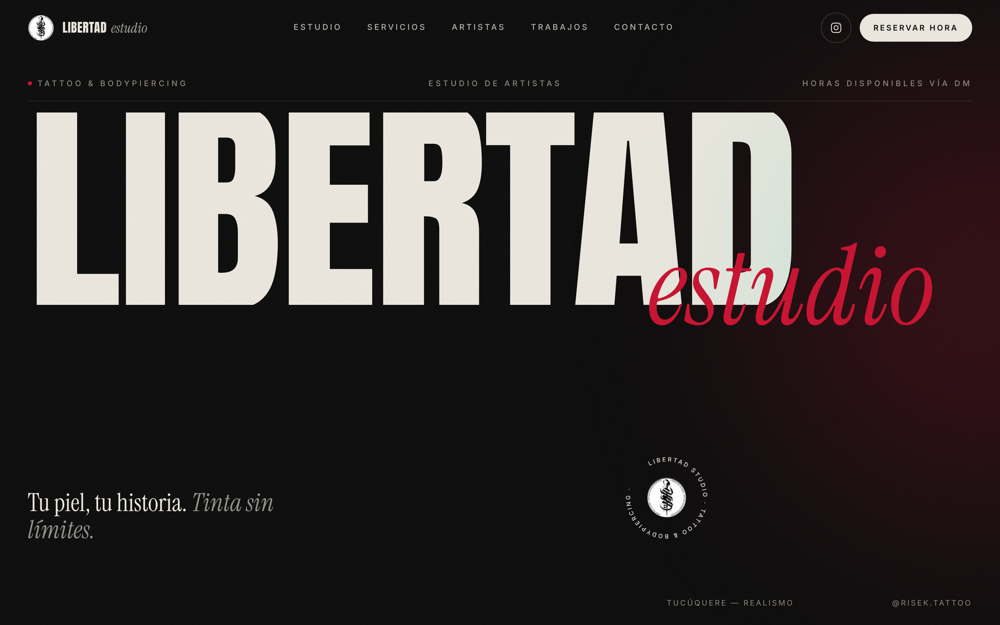
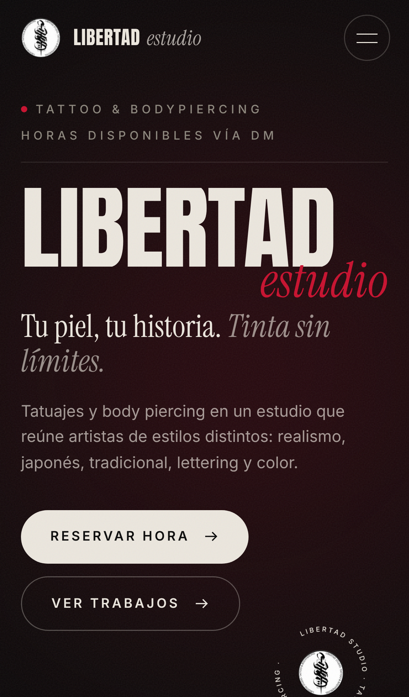

# Libertad Estudio — Sitio web

Sitio oficial de **Libertad Estudio · Tattoo & Bodypiercing**, construido con Next.js 16 (App Router), React 19 y Tailwind CSS 4.

<p align="center"> </p>

---

## Concepto creativo

**"Tinta sin límites."** El nombre del estudio, *Libertad*, es la idea central: libertad para elegir estilo, artista y la historia que cada persona quiere llevar en la piel. La web lo traduce en una estética **editorial y urbana**: tipografía protagonista, fotografía real del trabajo del estudio y mucho negro, como la tinta.

### Lo que se tomó del Instagram (@libertad_estudio_)

| Observado | Cómo se aplica en la web |
| --- | --- |
| Logo circular: monograma caligráfico negro sobre blanco, anillo "LIBERTAD STUDIO · TATTOO & BODYPIERCING" | Se usa el logo original. El anillo de texto se recrea como sello giratorio animado. |
| Paleta monocroma (negro, blanco, black & grey) con acentos rojos (pin-ups, alas, flamas) | Fondo tinta `#0a0a0a`, hueso `#ece7de` y rojo sangre `#c8102e` como único acento. |
| Caligrafía y lettering urbano (alfombra del estudio, piezas de lettering) | Titulares condensados en mayúsculas (Anton) en contraste con una serif itálica (Instrument Serif). |
| Colectivo de artistas: risek.tattoo, pereza.ink, atramentttoo, Tomazakre | Sección "Artistas" con enlaces a cada perfil y selector de artista en el formulario. |
| Estilos: realismo, black & grey, japonés, tradicional, lettering, color, fine line, cover-up | Cinta animada de estilos, filtros de galería y servicios. |
| "Horas disponibles vía DM" | El DM de Instagram es un canal de contacto principal y el formulario genera el mensaje listo para enviar. |

### Dirección de arte

- **Tipografía:** Anton (display), Instrument Serif itálica (acentos editoriales), Inter (texto).
- **Color:** negro y hueso, con el rojo reservado para acentos y llamados a la acción.
- **Textura:** grano de película sutil sobre toda la web.
- **Movimiento:** revelados con máscara, parallax suave y microinteracciones con relleno rojo. Respeta `prefers-reduced-motion`.

---

## Estructura

```
app/
  layout.tsx          SEO, fuentes, metadatos Open Graph
  page.tsx            Composición de secciones + JSON-LD (TattooParlor)
  api/contact/        Endpoint del formulario → webhook configurable
  sitemap.ts, robots.ts, icon.png, apple-icon.png
components/           Header, Hero, Marquee, About, Services, Artists,
                      Gallery (filtros + lightbox), Why, Contact, Footer…
lib/site.ts           ÚNICA fuente de contenido (textos, artistas, trabajos)
public/images/        Logo y fotos de trabajos
```

Todo el contenido editable está en **`lib/site.ts`**.

## Puesta en marcha

```bash
npm install
cp .env.example .env.local   # completa los datos
npm run dev                  # http://localhost:3000
npm run build && npm start   # producción
```

Se despliega directamente en Vercel o en cualquier hosting con Node 20 o superior.

## Configuración (`.env.local`)

| Variable | Uso |
| --- | --- |
| `NEXT_PUBLIC_SITE_URL` | Dominio final (SEO, sitemap, Open Graph). |
| `NEXT_PUBLIC_WHATSAPP` | Número en formato internacional, solo dígitos. Activa el botón flotante, el enlace en Contacto y el envío por WhatsApp. **Si está vacío, no se muestra ningún botón de WhatsApp.** |
| `NEXT_PUBLIC_EMAIL` | Correo de contacto (opcional). |
| `NEXT_PUBLIC_ADDRESS` | Dirección; muestra el bloque de ubicación con enlace a Google Maps (opcional). |
| `CONTACT_WEBHOOK_URL` | URL que recibe cada consulta en JSON (Make, Zapier, n8n, Formspree, Google Apps Script, etc.). |

### Formulario de contacto

`POST /api/contact` valida los datos, aplica un honeypot anti-spam y reenvía la consulta al webhook:

```json
{ "nombre": "", "contacto": "", "servicio": "", "artista": "", "zona": "", "tamano": "", "idea": "", "origen": "web", "fecha": "ISO-8601" }
```

Si el webhook aún no está configurado o falla, el usuario no pierde su mensaje: la web lo compone y ofrece enviarlo por WhatsApp o copiarlo y abrir el DM de Instagram.

## Pendiente por parte del estudio

- [ ] **Fotos originales en alta resolución.** Las imágenes actuales se recortaron de capturas de Instagram. Basta con reemplazar los archivos en `public/images/work/` manteniendo los nombres, o agregarlos en `works` dentro de `lib/site.ts`.
- [ ] Logo en SVG o PNG grande con transparencia (`public/images/logo.png`).
- [ ] Número de WhatsApp, correo y dirección (variables de entorno).
- [ ] Historia del estudio (año de apertura, fundadores), si se quiere contar en la sección "El estudio".
- [ ] Instagram de Tomazakre, para enlazarlo.
- [ ] Revisar los textos de servicios y del proceso de trabajo, y ajustarlos a cómo trabaja realmente el estudio.
